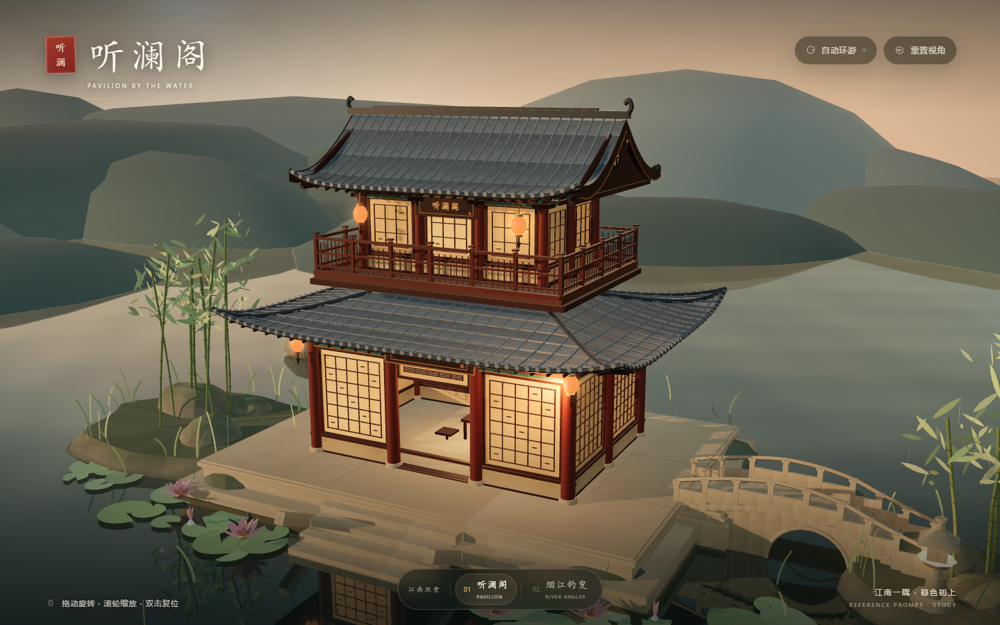
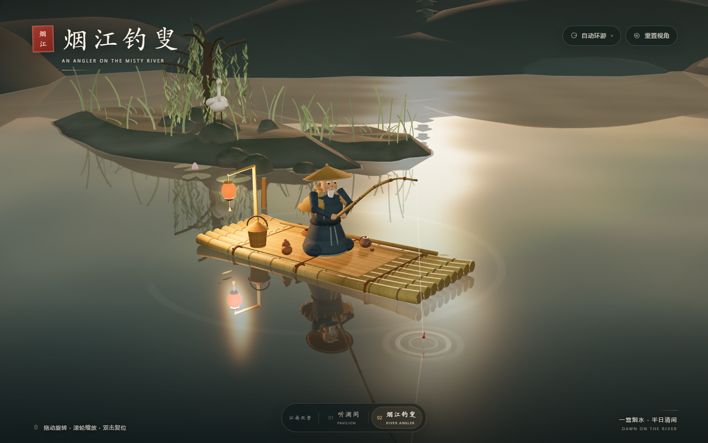

# 江南双景 · 听澜阁与烟江钓叟

把两座用 Three.js 程序化构建的江南微缩景合到同一个网页里：一座是暮色中的临水楼阁「听澜阁」，一座是清晨江雾里的竹筏钓叟「烟江钓叟」。底部标签栏一键切换，两个世界共用一套渲染器、相机与交互，切换时只更换当前场景。

<table>
  <tr>
    <td width="50%">
      
    </td>
    <td width="50%">
      
    </td>
  </tr>
  <tr>
    <td align="center"><sub>听澜阁 · 暮色临水</sub></td>
    <td align="center"><sub>烟江钓叟 · 清晨江雾</sub></td>
  </tr>
</table>

<sub>截图使用 1440×900 视口与固定机位模式生成，实际页面支持自由旋转与缩放。</sub>

## 快速预览

环境要求：Node.js **20.19+**（推荐 22 / 24）。

```bash
npm install
npm run dev
```

启动后打开终端里打印的地址（默认 **http://localhost:5173**）。Windows 也可以直接双击 `start.bat`，脚本会自动安装依赖、启动开发服务器并打开浏览器。

两个场景也可以直接用链接进入：

- 听澜阁：`http://localhost:5173/#tinglan`
- 烟江钓叟：`http://localhost:5173/#angler`

## 场景切换

- 页面底部是双景标签栏，点击「听澜阁 / 烟江钓叟」即可切换。
- 标签聚焦时可用 `←` / `→` 在场景间移动。
- 切换会同步更新地址栏 hash，浏览器前进 / 后退也能回到对应场景。
- 两个场景在启动时一并构建完成，加载页结束后切换无需等待，只做一次约 0.2 秒的淡入淡出。

## 画面交互

- **拖动 / 单指**：环绕旋转
- **滚轮 / 双指**：缩放视角
- **自动环游**：右上角按钮，或按 `空格`；手动操作后会短暂暂停再继续
- **重置视角**：右上角按钮，或双击画面，或按 `R`

每个场景有独立的初始机位、视场角、曝光、缩放范围与自动环游速度；打开即完整看到主体，移动端会按屏幕比例自动拉远取景。

## 两个场景

### 听澜阁

三开间、两层木构的临水楼阁：青灰色双层曲面瓦顶、微翘屋角、朱褐立柱、细木格窗、斗拱与二层栏杆；楼下石台、踏步、拱桥、石灯、山石、竹丛与荷叶，沉在傍晚暖光和水面倒影里。

- 自定义曲面屋顶：瓦垄、瓦当、正脊、垂脊、博风板与悬鱼
- 柱、梁、枋、雀替、斗拱、格扇窗、寻杖栏杆与挂落
- 实时反射水面、动态水纹、薄雾、浮尘与暮色天空
- 暖色夕阳、冷色天光、檐下灯笼与窗纸透光
- 匾额「听澜阁」与室内屏风、茶案陈设

### 烟江钓叟

清晨薄雾中的江心竹筏：戴斗笠、披蓑衣的老叟盘坐垂钓，竹筏上有鱼篓、茶壶茶盏、酒葫芦与撑篙，筏尾一盏红纸灯笼；左岸芦苇垂柳、白鹭与远飞的鸟，远处淡墨山峦和一座小塔的剪影。

- 九根竹竿扎成的竹筏、麻绳捆扎、竹席与筏上器物
- 斗笠、层叠蓑衣、白须与靛青布衣逐层搭建
- 弯曲竹钓竿、鱼线、红白浮漂与扩散的涟漪
- 实时水面反射、贴水晨雾、低角度暖光与灯笼冷暧对比
- 白鹭、飞鸟、垂柳、芦苇、远山与塔影

所有几何体与纹理均在运行时程序化生成，不依赖外部模型、图片或字体文件。

## 正式构建

```bash
npm run build
npm run preview
```

预览地址：**http://localhost:4173**。构建产物位于 `dist/`，可部署到任意静态文件服务器。

## 项目结构

```text
jiangnan-scenes/
├─ index.html
├─ src/
│  ├─ main.js                # 共享渲染器、相机、交互、标签切换与界面联动
│  ├─ style.css              # 东方极简界面、标签栏、加载页与响应式布局
│  └─ scenes/
│     ├─ registry.js         # 场景注册：标题、机位、曝光、缩放与环游参数
│     ├─ shared/             # 两个场景复用的几何构造与纹理工具
│     │  ├─ geometry.js
│     │  └─ textures.js
│     ├─ tinglan/
│     │  ├─ lib/             # 石材/木纹/瓦面纹理、材质、曲面屋顶
│     │  └─ scene/           # 楼阁、园林、水面、天空与场景装配
│     └─ angler/
│        ├─ lib/             # 竹木/布料纹理与材质
│        └─ scene/           # 竹筏、钓叟、江岸、水面、天空与场景装配
├─ docs/screenshots/         # README 展示截图
├─ PROMPT-angler.md          # 烟江钓叟的可复用场景提示词
├─ LICENSE
├─ start.bat
└─ package.json
```

## 实现说明

- 两个场景各自导出 `createWorld(renderer)`，共用同一个 `WebGLRenderer`、`PerspectiveCamera` 和 `OrbitControls`；主循环只更新、渲染当前激活的场景。
- 场景差异集中到 `src/scenes/registry.js`：标题、印章、英文副标题、视场角、初始机位、取景宽高、曝光、缩放范围与自动环游速度，界面文案与相机参数都由它驱动。
- 两个场景共用的几何构造与通用纹理生成器收敛在 `src/scenes/shared/`，场景目录只保留各自的材质配色、造型与场景装配。
- 标签切换使用 hash 路由（`#tinglan` / `#angler`），并通过 `pushState` 与 `popstate` 支持浏览器前进后退。
- 地址后追加 `?still=1` 可进入固定机位展示模式：关闭自动环游与界面过渡，便于截图和嵌入展示。
- 渲染使用 ACES 色调映射、PCF 软阴影与受限设备像素比，兼顾质感与移动端性能。
- 对 `prefers-reduced-motion` 做了适配：系统要求减少动态效果时默认不自动环游，按钮仍可手动开启。
- 水面由实时反射层叠加动态法线水纹构成，楼阁飞檐、竹筏、灯影与远山都会进入倒影。

## 来源说明

「听澜阁」的场景概念、需求描述与交互设定参考自一份外部的项目提示词，概念并非完全原创；Three.js 场景实现、程序化建模、材质、灯光与界面代码由本项目独立完成。由于提示词来源未附带原作者与项目链接，暂以“外部提示词参考”标注；如原作者或原项目希望补充署名、调整表述，欢迎联系。

「烟江钓叟」沿用了同一套江南微缩景的创作方向，其场景描述整理为可复用提示词，见 [PROMPT-angler.md](PROMPT-angler.md)。

## 许可证

代码以 MIT License 发布，详见 [LICENSE](LICENSE)。场景概念与提示词的参考说明见上方“来源说明”。
